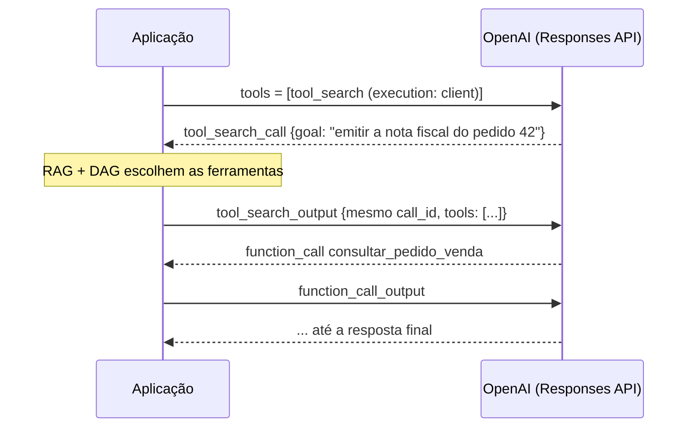
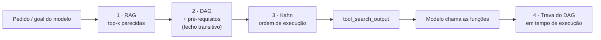
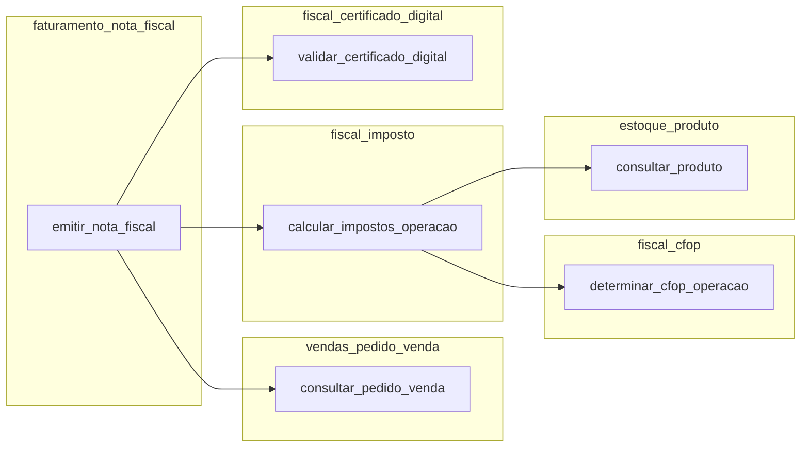

<p align="center">
  
</p>

<h1 align="center">tool-search-rag-dag</h1>

<p align="center">
  <b>Como entregar 250 ferramentas a um LLM sem mandar as 250 em toda chamada.</b><br>
  Tool search da OpenAI + RAG para achar as ferramentas + DAG (ordenação de Kahn) para trazer os pré-requisitos na ordem certa.
</p>

<p align="center">
  
  
  
</p>

---

## Sumário

- [Objetivo do projeto](#objetivo-do-projeto)
- [Início rápido](#início-rápido)
- [O problema](#o-problema)
- [Tool search da OpenAI](#tool-search-da-openai)
- [`defer_loading`: carregar sob demanda](#defer_loading-carregar-sob-demanda)
- [As abordagens de performance](#as-abordagens-de-performance)
  - [1. RAG: achar as ferramentas parecidas com o pedido](#1-rag-achar-as-ferramentas-parecidas-com-o-pedido)
  - [2. DAG: trazer as ferramentas necessárias](#2-dag-trazer-as-ferramentas-necessárias)
  - [3. Algoritmo de Kahn: a ordem de execução](#3-algoritmo-de-kahn-a-ordem-de-execução)
  - [4. Trava em tempo de execução](#4-trava-em-tempo-de-execução)
  - [5. RAG + DAG juntos](#5-rag--dag-juntos)
- [Os cinco modos comparados](#os-cinco-modos-comparados)
- [Benchmark](#benchmark)
- [Como rodar](#como-rodar)
- [Arquitetura](#arquitetura)
- [Contribuindo](#contribuindo)

## Objetivo do projeto

Agentes de verdade (ERPs, CRMs, plataformas internas) facilmente passam de **centenas de
ferramentas**. Mandar todas em cada chamada ao modelo é caro, lento e piora a escolha da ferramenta
certa.

Este repositório é uma **POC aberta e didática** que mostra, com código legível e números medidos,
como resolver isso combinando três ideias:

| Ideia | Pergunta que responde |
|---|---|
| **Tool search** (OpenAI) | Como o modelo pede ferramentas sob demanda, sem perder o cache do prompt? |
| **RAG** | Quais ferramentas se **parecem** com o pedido do usuário? |
| **DAG + Kahn** | Quais outras ferramentas são **necessárias** para essas funcionarem, e em que ordem? |

O objetivo é servir de **referência para quem precisa escalar o número de ferramentas de um
agente**: cada conceito está isolado numa classe pequena, há um cenário executável para cada
afirmação e os resultados estão documentados. Use, copie, adapte e mande melhorias.

O domínio de exemplo é um ERP fictício com **250 ferramentas**, 50 namespaces e 114 dependências
entre ferramentas (vendas, faturamento, fiscal, estoque, financeiro...). A execução das
ferramentas é simulada: o foco é a **seleção** de ferramentas, não o ERP.

## Início rápido

Requisitos: **Java 17+** e **Maven 3.8+**. Para os comandos que chamam o modelo, uma
[chave da OpenAI](https://platform.openai.com/api-keys).

```bash
git clone https://github.com/CaioMC/tool-search-rag-dag.git
cd tool-search-rag-dag
mvn package                                   # compila, roda os testes, gera target/tool-search-rag-dag.jar

./toolsearch plano emitir_nota_fiscal         # sem chave: a ordem que o DAG exige
./toolsearch buscar "emita a nota fiscal do pedido 42"   # sem chave: RAG (BM25) + DAG
```

Para chamar o modelo, coloque a sua chave e pronto:

```bash
cp .env.example .env                          # o .env está no .gitignore
# edite .env: OPENAI_API_KEY=sk-...

./toolsearch agente "Emita a nota fiscal do pedido de venda 42" --modo client
./toolsearch comparar "Emita a nota fiscal do pedido de venda 42" --detalhes
```

A única variável obrigatória é `OPENAI_API_KEY`. Por padrão a POC usa a API oficial
(`https://api.openai.com/v1`) e o modelo `gpt-5.4-mini`. Para usar um proxy compatível
(LiteLLM, gateway da empresa...), defina `OPENAI_BASE_URL`. Veja todas as
[variáveis de ambiente](#variáveis-de-ambiente).

## O problema

| Problema | Por quê |
|---|---|
| **Custo e lentidão** | As 250 definições são reenviadas **a cada chamada** do laço do agente. Uma tarefa de 7 passos manda o catálogo 7 vezes. |
| **Limite da API** | Na Chat Completions o campo `tools` aceita no máximo **128** itens (`Invalid 'tools': array too long`). Na Responses API as 250 são aceitas, mas o custo continua. |
| **Qualidade** | Quanto mais ferramentas parecidas, mais o modelo confunde (`incluir_nota_fiscal` × `emitir_nota_fiscal`). |

A saída é **não mandar tudo**: mandar só o que a tarefa precisa. O restante deste README mostra
como decidir "o que a tarefa precisa".

## Tool search da OpenAI

O **tool search** é um recurso da [Responses API](https://developers.openai.com/api/reference/resources/responses)
(modelos **`gpt-5.4` em diante**) em que o modelo recebe uma ferramenta especial, `tool_search`, e
**pede** as ferramentas de que precisa no meio da conversa, em vez de receber todas de início.

O ponto mais importante: as ferramentas carregadas entram **no fim** do contexto. O começo do
prompt (instruções + `tools`) não muda entre as chamadas, então o
[cache de prompt](https://developers.openai.com/api/docs/guides/prompt-caching) continua valendo.

Há duas formas de usar:

| | Hospedado (`execution: "server"`) | No cliente (`execution: "client"`) |
|---|---|---|
| Quem busca | A **OpenAI**, entre as funções que você declarou | A **sua aplicação**, como quiser |
| O que vai na 1ª chamada | `tool_search` + todas as funções com `defer_loading` | Só o `tool_search` (com o esquema de argumentos que você definir) |
| O que a aplicação faz | Nada: `tool_search_call` e `tool_search_output` já vêm resolvidos | Recebe `tool_search_call`, busca e responde com `tool_search_output` (mesmo `call_id`) |
| Quando usar | O inventário de funções é fixo e conhecido | A busca depende de estado seu: projeto, tenant, **dependências entre ferramentas** |



**É no modo cliente que esta POC pluga o RAG + DAG**: o `tool_search` vira a "tomada" onde
entra a nossa inteligência de seleção.

Referências oficiais:

- [Tool search (guia)](https://developers.openai.com/api/docs/guides/tools-tool-search)
- [Function calling (guia)](https://developers.openai.com/api/docs/guides/function-calling)
- [Migrar para a Responses API](https://developers.openai.com/api/docs/guides/migrate-to-responses)
- [Prompt caching](https://developers.openai.com/api/docs/guides/prompt-caching)

## `defer_loading`: carregar sob demanda

`defer_loading: true` é uma marcação na definição de uma função que diz à OpenAI: **"declaro esta
função, mas não coloque o schema dela no contexto do modelo agora; ela só entra quando o
`tool_search` pedir"**.

```json
{"tools": [
  {"type": "tool_search"},
  {"type": "namespace", "name": "faturamento_nota_fiscal",
   "description": "Faturamento - nota fiscal (NF-e).",
   "tools": [
     {"type": "function", "name": "emitir_nota_fiscal", "defer_loading": true,
      "description": "...", "parameters": {"...": "..."}}
   ]}
]}
```

Como funciona, passo a passo:

1. **1ª chamada:** o modelo vê o `tool_search` e um **resumo** do que pode ser buscado. Com
   namespaces, o resumo é só nome + descrição de cada namespace. Os schemas das funções não
   entram.
2. **O modelo decide** o que precisa e emite um `tool_search_call`.
3. **As funções escolhidas são carregadas** num `tool_search_output`, com os schemas completos,
   no **fim** do histórico (cache preservado).
4. **O modelo chama** as funções carregadas normalmente (`function_call`).

**Namespaces são essenciais.** O `defer_loading` vale para as funções **dentro** do namespace; o
namespace em si é o "índice" que o modelo consulta. A OpenAI recomenda menos de 10 funções por
namespace. Medimos o que acontece sem eles: 250 funções deferidas **sem namespace** custaram
**6.107** tokens de entrada, mais que as 250 funções normais com descrições curtas (2.773). Deferir
sem agrupar não economiza, porque o modelo ainda precisa ver nome e descrição de cada função.

**A limitação que a POC encontrou:** a busca hospedada só enxerga nomes e descrições. Ela não sabe
que `emitir_nota_fiscal` precisa de `calcular_impostos_operacao`, que mora em **outro
namespace**. O modelo carrega um namespace, tenta, falha, busca de novo... (6 buscas no
[benchmark](#benchmark)). É isso que o DAG resolve.

Na POC: modo `hosted` → `ResponsesToolMapper.namespaces`; modo `client` → as funções devolvidas no
`tool_search_output` também levam `defer_loading: true`, como o guia pede.

## As abordagens de performance

O caminho de um pedido no modo `client`:



### 1. RAG: achar as ferramentas parecidas com o pedido

RAG (*Retrieval-Augmented Generation*) é buscar contexto relevante e entregar ao modelo. Aqui o
"documento" é a ferramenta (nome + namespace + descrição + parâmetros) e a busca responde:
**quais ferramentas se parecem com o que o usuário pediu?** Devolve as top-k (padrão 5).

| Estratégia | Como funciona | Bom em | Ruim em |
|---|---|---|---|
| **BM25** (`Bm25RetrieverRag`) | Ranking lexical (o do Lucene/Elasticsearch): termos raros em comum valem mais | Local, grátis, determinístico | Sinônimos e siglas: "NF-e" ≠ "nota fiscal"; "gerar NF" puxa `gerar_balancete` |
| **Embeddings** (`EmbeddingRetrieverRag`) | Cada texto vira um vetor; similaridade de cosseno | Significado: "NF-e" acha nota fiscal | Uma chamada à API por pergunta; precisa de índice |

O que o RAG **não** resolve: ele traz o que é **parecido**, não o que é **necessário**. Para
"emita a nota fiscal do pedido 42", `emitir_nota_fiscal` vem em 1º. Mas
`determinar_cfop_operacao` (de que ela depende, indiretamente) não tem nenhuma palavra em comum
com o pedido e fica de fora.

### 2. DAG: trazer as ferramentas necessárias

Um **DAG** (*directed acyclic graph*, grafo acíclico dirigido) é um conjunto de nós ligados por
setas, sem ciclos. Aqui: **nó = ferramenta**, **seta `A → B` = "A depende de B"** (B roda antes).
As arestas vêm do campo `dependsOn` de cada ferramenta no catálogo.

As 6 ferramentas de que `emitir_nota_fiscal` precisa (ela inclusa) estão em **6 namespaces diferentes**:



O DAG responde três perguntas que o RAG sozinho não responde (`ToolDependencyDag`):

| Pergunta | Método | Técnica |
|---|---|---|
| Se o modelo vai usar A, de quais outras ele precisa? | `withAllPrerequisites` | Fecho transitivo (percurso em largura, com fila) |
| Em que ordem executá-las? | `executionOrder` | **Ordenação topológica, algoritmo de Kahn** |
| Posso executar A agora, dado o que já rodou? | `missingPrerequisites` | Diferença de conjuntos |

"Acíclico" é obrigatório: se A precisa de B e B precisa de A, nenhuma das duas roda nunca. Por
isso `ToolDependencyDag.of(...)` valida o grafo uma vez, ao subir a aplicação, com uma DFS
(estados *visitando*/*concluído*), e recusa catálogos com ciclo apontando o ciclo exato:
`analisar_credito -> consultar_pedido -> aprovar_pedido -> analisar_credito`.

### 3. Algoritmo de Kahn: a ordem de execução

Depois do fecho, o grafo é ordenado com o **algoritmo de Kahn** (ordenação topológica):

1. Conta quantos pré-requisitos pendentes cada ferramenta tem.
2. As que têm **zero** vão para uma fila de "prontas".
3. Tira uma da fila, coloca na ordem e decrementa o contador de quem depende dela. Quem chegar a
   zero entra na fila.
4. Repete até a fila esvaziar.

```text
$ ./toolsearch plano emitir_nota_fiscal
   1. consultar_pedido_venda
   2. consultar_produto
   3. determinar_cfop_operacao
   4. calcular_impostos_operacao    precisa de: consultar_produto, determinar_cfop_operacao
   5. validar_certificado_digital
   6. emitir_nota_fiscal            precisa de: calcular_impostos_operacao, consultar_pedido_venda, validar_certificado_digital
```

**Por que Kahn:**

| Motivo | Detalhe |
|---|---|
| **Pré-requisitos sempre antes** | É a definição de ordem topológica: toda seta `A → B` é respeitada. |
| **Linear** | O(V + E). Com o fecho de uma tarefa (dezenas de nós), é instantâneo. |
| **Determinístico** | A fila de prontas é uma `PriorityQueue`: empates saem em ordem alfabética. Mesma entrada, mesma lista, o que deixa o prompt estável para o cache e os testes reprodutíveis. |
| **Iterativo e legível** | Sem recursão; a fila de "prontas" é literalmente "o que já pode rodar". |
| **Paralelizável** | Cada "leva" de nós prontos ao mesmo tempo é independente entre si: dá para executar em paralelo (próximo passo possível). |

A ordem vai para o modelo de duas formas: a **lista** do `tool_search_output` já sai ordenada, e
a **descrição** de cada função ganha `Pré-requisitos (executar antes): ...`.

### 4. Trava em tempo de execução

O modelo pode ignorar a ordem. Por isso o DAG também é regra: `RunAgentService` só executa uma
ferramenta se os pré-requisitos diretos já rodaram nesta conversa. Senão, a chamada **não roda** e
o modelo recebe:

```json
{"erro": "pre_requisito_pendente", "executar_antes": ["calcular_impostos_operacao"]}
```

Na prática o modelo se corrige sozinho: executa o que falta e tenta de novo.

### 5. RAG + DAG juntos

Eles respondem perguntas diferentes e se completam:

```text
pedido ──► RAG ──► emitir_nota_fiscal                    (parecida com o pedido)
                        │
                        ▼
                  DAG ──► + consultar_pedido_venda, consultar_produto,
                          determinar_cfop_operacao, calcular_impostos_operacao,
                          validar_certificado_digital    (necessárias, não parecidas)
                        │
                        ▼
                  Kahn ──► ordem de execução ──► tool_search_output
```

Um custo a conhecer: o DAG expande **tudo** o que o RAG trouxe, inclusive acertos ruidosos (se o
BM25 traz `aprovar_pedido_venda`, vêm junto os pré-requisitos dela). Um RAG mais preciso
(híbrido, com nota mínima) reduz esse ruído.

## Os cinco modos comparados

A POC implementa as cinco formas de entregar ferramentas ao modelo e mede todas com o mesmo pedido:

| Modo | O que vai para o modelo | Quem escolhe as ferramentas |
|---|---|---|
| `prompt` | 250 descritas em texto no prompt + 1 função genérica | ninguém (abordagem ingênua) |
| `todas` | 250 funções no campo `tools` | ninguém |
| `preselecao` | só as top-k + pré-requisitos, antes da 1ª chamada | **RAG + DAG** |
| `hosted` | 250 com `defer_loading`, em 50 namespaces | a **OpenAI** (`tool_search` hospedado) |
| `client` | só a ferramenta `tool_search` | o **modelo pede**, o nosso **RAG + DAG** responde |

## Benchmark

Pedido: **"Emita a nota fiscal do pedido de venda 42"**: 6 ferramentas necessárias, 3 níveis de
dependência, espalhadas por 6 namespaces. Modelo `gpt-5.4-mini`, RAG BM25 top 5, catálogo de 250
ferramentas. Medido em 06/10/2026.

| Modo | Tokens de entrada | vs. `todas` | Chamadas ao modelo | Buscas | Tempo |
|---|---:|---:|---:|---:|---:|
| `todas` | 189.359 | 1× | 11 | — | 28,5 s |
| `prompt` | 69.496 | 2,7× menos | 7 | — | 13,6 s |
| `hosted` | 38.869 | 4,9× menos | 8 | 6 | 24,1 s |
| **`client` (RAG + DAG)** | **14.453** | **13,1× menos** | 9 | **1** | 15,6 s |
| **`preselecao` (RAG + DAG)** | **13.489** | **14,0× menos** | 10 | — | 13,2 s |

**Em uma frase:** RAG + DAG mandou **~13× menos tokens** que mandar todas as ferramentas e
resolveu as dependências com **uma** busca, enquanto o tool search hospedado precisou de seis.

O que os números mostram:

1. **`todas` é o pior caso:** as 250 definições com JSON Schema vão em cada uma das 11 chamadas.
2. **`prompt`** é mais barato que `todas` (texto é mais compacto que JSON Schema), mas ainda manda
   ~5× mais que `client`.
3. **`hosted`** economiza, mas busca um namespace por vez porque não conhece as dependências.
4. **`client` e `preselecao`** são os mais baratos. `client` ainda deixa o modelo buscar de novo
   se a tarefa mudar no meio; `preselecao` funciona com **qualquer** modelo (sem tool search).
5. **A trava do DAG funcionou em todos os modos:** chamadas fora de ordem foram barradas e o modelo
   se corrigiu.

> LLMs não são determinísticos: rodando de novo, os números mudam. Use-os como ordem de grandeza e
> meça você mesmo com `./toolsearch comparar "<pedido>" --detalhes`. Detalhes, trechos das
> execuções, BM25 × embeddings e o efeito do top-k em [docs/resultados.md](docs/resultados.md).

## Como rodar

### Sem chave (tudo local)

```bash
./toolsearch catalogo                                             # 250 ferramentas, 50 namespaces, 114 dependências
./toolsearch plano emitir_nota_fiscal                             # ordem de execução pelo DAG (Kahn)
./toolsearch buscar "emita a nota fiscal do pedido 42"            # RAG (BM25) + DAG
./toolsearch buscar "emita a nota fiscal do pedido 42" --sem-dag  # só RAG: veja o que falta
```

### Com o modelo

```bash
./toolsearch buscar "gerar NF-e para o pedido 42" --estrategia embedding   # RAG semântico
./toolsearch agente "Emita a nota fiscal do pedido de venda 42" --modo client
./toolsearch agente "Emita a nota fiscal do pedido de venda 42" --modo hosted
./toolsearch comparar "Emita a nota fiscal do pedido de venda 42" --detalhes

# top-k pequeno demais: o RAG não traz efetuar_pagamento_titulo_pagar e o modelo diz que não tem a ferramenta
./toolsearch comparar "Pague o título 77 do fornecedor" --modos client,preselecao --estrategia embedding --top 3
# com top 8 ela vem, e o DAG completa com projetar_fluxo_caixa e consultar_conta_bancaria
./toolsearch agente "Pague o título 77 do fornecedor" --modo client --estrategia embedding --top 8
```

### Pela IDE, sem argumentos

Cada caso de [docs/como-testar.md](docs/como-testar.md) tem uma classe com `main` em
`adapters/cli/scenario`: `local/` (B1 a B7, sem chave) e `model/` (C1 a C7, chamam o modelo).
`local/ScenarioAllLocal` roda todos os que não precisam de chave.

### Variáveis de ambiente

Lidas do `.env` na raiz do projeto (modelo em [`.env.example`](.env.example)). Variável exportada
no terminal tem prioridade sobre o `.env`; variável vazia vale o padrão.

| Variável | Padrão | Para quê |
|---|---|---|
| `OPENAI_API_KEY` | **obrigatória** para o modelo | sua chave da OpenAI |
| `OPENAI_BASE_URL` | `https://api.openai.com/v1` | outro servidor compatível (proxy LiteLLM, gateway...) |
| `OPENAI_MODEL` | `gpt-5.4-mini` | precisa ser `gpt-5.4`+ para `hosted` e `client` |
| `OPENAI_EMBEDDING_MODEL` | `text-embedding-3-small` | RAG semântico |
| `OPENAI_TIMEOUT_SECONDS` | `120` | timeout por chamada |
| `TOOLSEARCH_CATALOG` | `catalog/erp-tools.json` (classpath) | outro catálogo JSON (veja o formato abaixo) |
| `TOOLSEARCH_ENV_FILE` | `.env` | outro arquivo de variáveis |

### Usando o seu próprio catálogo

```json
{
  "namespaces": [{"name": "faturamento_nota_fiscal", "description": "Faturamento - nota fiscal (NF-e)."}],
  "tools": [{
    "name": "emitir_nota_fiscal",
    "namespace": "faturamento_nota_fiscal",
    "domain": "faturamento",
    "description": "Emite e transmite a NF-e para a SEFAZ.",
    "parameters": [{"name": "codigo", "type": "string", "description": "Código da nota.", "required": true}],
    "dependsOn": ["consultar_pedido_venda", "calcular_impostos_operacao", "validar_certificado_digital"]
  }]
}
```

```bash
TOOLSEARCH_CATALOG=/caminho/meu-catalogo.json ./toolsearch catalogo
```

O catálogo de exemplo (`src/main/resources/catalog/erp-tools.json`) é gerado por
`scripts/gerar_catalogo.py`: 10 domínios × 5 entidades × 5 ações, cada entidade um namespace.

## Arquitetura

Clean Architecture sem framework de injeção de dependência, de propósito: `ApplicationFactory`
liga tudo à mão, então dá para seguir cada dependência lendo o código.

```
agent ──► retrieval ──► catalog
(laço do agente)  (RAG)        (ferramentas e DAG)
```

| Domínio | Responsabilidade |
|---|---|
| `catalog` | O que são as ferramentas e quem depende de quem (DAG) |
| `retrieval` | Achar as ferramentas de um pedido (RAG) e completar com o DAG |
| `agent` | Conversar com o modelo, responder `tool_search`, executar com a trava do DAG |

`adapters` conhece `core`; `core` não conhece `adapters`. Trocar a OpenAI por outro provedor, o
JSON por um banco ou o ERP simulado por um real é escrever outro adapter.

### Onde olhar primeiro

| Quer entender... | Abra |
|---|---|
| o DAG (fecho, Kahn, trava, detecção de ciclo) | `core/catalog/domain/model/ToolDependencyDag.java` |
| RAG + DAG juntos (ponto único da seleção) | `core/retrieval/application/SelectToolsService.java` |
| só o RAG | `core/retrieval/application/rag/ToolSearchRag.java` |
| só o passo DAG | `core/retrieval/application/dag/PrerequisiteExpanderDag.java` |
| o laço do agente e a trava | `core/agent/application/RunAgentService.java` |
| o JSON de `tool_search`, `namespace`, `defer_loading` | `adapters/agent/openai/mapper/ResponsesToolMapper.java` |
| `tool_search_call` → `tool_search_output` | `adapters/agent/openai/mapper/ResponsesOutputParser.java`, `adapters/agent/openai/OpenAiResponsesSession.java` |

### Documentação

1. [docs/conceitos.md](docs/conceitos.md): tool search, RAG, DAG e por que RAG **e** DAG.
2. [docs/resultados.md](docs/resultados.md): números medidos e recomendações.
3. [docs/sequencias.md](docs/sequencias.md): diagramas de sequência com as classes reais.
4. [docs/como-testar.md](docs/como-testar.md): roteiro de testes, do `mvn verify` a um catálogo próprio.

### Testes

```bash
mvn verify
```

Sem rede: o core é testado com dublês escritos à mão (incluindo um modelo roteirizado e embeddings
de brinquedo), e o adapter OpenAI contra um `HttpServer` local do JDK com respostas reais
capturadas (`src/test/resources/openai/`).

### Achados de integração

- Proxies como o LiteLLM acrescentam campos nulos (ex.: `created_by`) nos itens de saída, e a
  OpenAI recusa esses campos quando o item é reenviado no `input`. `OpenAiResponsesSession` remove
  nulos antes de reenviar.
- A conversa é sem estado no servidor: cada chamada reenvia o histórico. As ferramentas carregadas
  pelo tool search entram no fim, então o começo do prompt fica igual e o cache vale.
- Funções vão com `strict: false`: o tool search não aceita `strict: true` e há parâmetros opcionais.

## Contribuindo

Issues e pull requests são bem-vindos. Ideias de próximos passos:

- RAG híbrido (BM25 + embeddings com *reciprocal rank fusion*) e nota mínima.
- Índice de embeddings persistente (pgvector, OpenSearch) em vez de em memória.
- Executar em paralelo as ferramentas de uma mesma "leva" do Kahn.
- Conjunto de avaliação com vários pedidos: taxa de acerto da tarefa, tokens e latência.

Antes de abrir um PR, rode `mvn verify`.
