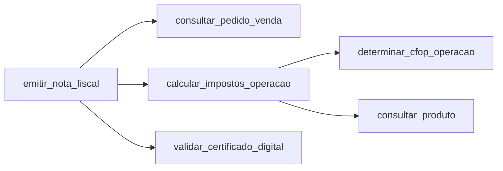

# Conceitos: tool search, RAG e DAG

Este documento explica as ideias por trás da POC, na ordem em que elas se encaixam.

## 1. O problema

Um agente de ERP facilmente chega a **250 ferramentas**. O caminho ingênuo é descrever todas em
texto no prompt de sistema (ou mandar todas no campo `tools`). Isso traz três problemas:

| Problema | Por quê |
|---|---|
| Lentidão e custo | As 250 descrições são reenviadas **a cada chamada** do laço do agente. Uma tarefa de 7 passos manda o catálogo 7 vezes. |
| Limite da API | Na **Chat Completions** o campo `tools` aceita no máximo **128** itens. Medimos: `Invalid 'tools': array too long. Expected an array with maximum length 128, but got an array with length 250`. Na **Responses API** as mesmas 250 foram aceitas. |
| Qualidade | Quanto mais ferramentas parecidas, mais o modelo confunde (`incluir_nota_fiscal` × `emitir_nota_fiscal`). |

A saída é **não mandar tudo**: mandar só o que a tarefa precisa. Há três formas de decidir "o que a
tarefa precisa", e a POC implementa todas.

## 2. Tool search (OpenAI, Responses API)

Referência: <https://developers.openai.com/api/docs/guides/tools-tool-search>. Só modelos
`gpt-5.4` em diante.

A ideia: o modelo recebe uma ferramenta especial, `tool_search`, e **pede** as ferramentas de que
precisa. As ferramentas carregadas entram **no fim** do histórico, então o começo do prompt não
muda e o cache de prompt continua valendo.

### 2.1 Hospedado (`execution: "server"`) — a OpenAI busca

Declaramos todas as funções com `defer_loading: true`, de preferência em `namespace`s pequenos
(a OpenAI recomenda menos de 10 funções por namespace). O modelo vê só nome e descrição dos
namespaces e carrega o que quiser.

```json
{"tools": [
  {"type": "tool_search"},
  {"type": "namespace", "name": "faturamento_nota_fiscal", "description": "Faturamento - nota fiscal (NF-e).",
   "tools": [{"type": "function", "name": "emitir_nota_fiscal", "defer_loading": true, "...": "..."}]}
]}
```

A resposta traz um `tool_search_call` e um `tool_search_output` já resolvidos (`call_id: null`).
Não há nada para a aplicação responder.

**Limitação que a POC mostrou:** a busca hospedada não sabe que `emitir_nota_fiscal` precisa de
`calcular_impostos_operacao`, que está em **outro namespace**. O modelo carrega um namespace, tenta,
descobre que falta algo, busca de novo... (6 buscas no nosso teste — ver [resultados](resultados.md)).

### 2.2 No cliente (`execution: "client"`) — a nossa aplicação busca

Declaramos só a ferramenta de busca, com o esquema de argumentos que quisermos:

```json
{"type": "tool_search", "execution": "client",
 "description": "Busca no catálogo do ERP as ferramentas necessárias para a tarefa.",
 "parameters": {"type": "object", "properties": {"goal": {"type": "string"}}, "required": ["goal"]}}
```

O modelo responde com:

```json
{"type": "tool_search_call", "execution": "client", "call_id": "call_abc", "arguments": {"goal": "emitir a nota fiscal do pedido 42"}}
```

A aplicação busca como quiser (aqui: **RAG + DAG**) e devolve, **com o mesmo `call_id`**:

```json
{"type": "tool_search_output", "execution": "client", "call_id": "call_abc", "status": "completed",
 "tools": [{"type": "function", "name": "emitir_nota_fiscal", "defer_loading": true, "...": "..."}]}
```

É aqui que o RAG e o DAG entram: o modo cliente é o "plugue" para colocarmos a nossa inteligência
de seleção dentro do tool search.

### 2.3 Pré-seleção (sem tool search)

Antes de chamar o modelo, a aplicação roda RAG + DAG sobre o pedido do usuário e manda só as
top-k como funções normais. Funciona com **qualquer modelo** que aceite function calling (gpt-4o, ou Gemini e Claude por um proxy compatível),
mas a seleção é feita uma vez, sobre o pedido original; se a tarefa mudar no meio, o modelo não tem
como pedir mais.

## 3. RAG: encontrar ferramentas parecidas com o pedido

RAG (*Retrieval-Augmented Generation*) é buscar contexto relevante e entregar ao modelo. Aqui o
"documento" é a ferramenta (nome + namespace + descrição + parâmetros) e a "busca" responde:
*quais ferramentas se parecem com o que o usuário pediu?*

| Estratégia | Como funciona | Bom em | Ruim em |
|---|---|---|---|
| **BM25** (`Bm25RetrieverRag`) | Ranking lexical clássico (Lucene/Elasticsearch): termos raros em comum valem mais. | Local, grátis, determinístico, explica a nota. | Sinônimos e siglas: "NF-e" ≠ "nota fiscal", "gerar NF" puxa `gerar_balancete`. |
| **Embeddings** (`EmbeddingRetrieverRag`) | Cada texto vira um vetor; similaridade de cosseno. | Significado: "NF-e" acha nota fiscal. | Custa uma chamada por pergunta; precisa de índice (aqui em memória). |

Em produção o normal é **híbrido** (BM25 + embeddings, combinados por *reciprocal rank fusion*) e
um banco vetorial (pgvector, OpenSearch). A porta `ToolRetrieverRag` existe para isso ser só mais uma
implementação.

**O que o RAG não sabe:** que uma ferramenta depende de outra. `calcular_impostos_operacao` não se
parece com "emita a nota fiscal", então o RAG não traz, e sem ela não dá para emitir.

## 4. DAG: dependências entre ferramentas

Um **DAG** (*directed acyclic graph*, grafo acíclico dirigido) é um conjunto de nós com setas, sem
ciclos. Aqui: nó = ferramenta, seta `A → B` = "A depende de B" (B roda antes).



"Acíclico" é obrigatório: se A precisa de B e B precisa de A, nenhuma das duas roda nunca.
`ToolDependencyDag.of(...)` recusa catálogos com ciclo (`CyclicDependencyException`).

O DAG é usado em **três momentos** na POC:

| Momento | Método | Para quê |
|---|---|---|
| Seleção | `PrerequisiteExpanderDag` → `withAllPrerequisites` + `executionOrder` | Completar o que o RAG achou com os pré-requisitos (fecho transitivo) e ordenar (ordenação topológica, algoritmo de Kahn). |
| Descrição | `ResponsesToolMapper` | A descrição de cada função diz "Pré-requisitos (executar antes): ...", para o modelo planejar. |
| Execução | `missingPrerequisites` | Trava em tempo de execução: se o modelo chamar `emitir_nota_fiscal` antes de calcular os impostos, a chamada **não roda** e o modelo recebe `{"erro":"pre_requisito_pendente","executar_antes":[...]}`. Na maioria das execuções o modelo se corrigiu sozinho; numa execução do modo hospedado ele desistiu, porque não conseguia carregar o pré-requisito que estava em outro namespace. |

## 5. RAG **e** DAG (não "ou")

Eles respondem perguntas diferentes e se completam:

```
pedido ──► RAG ──► "emitir_nota_fiscal" (parecida com o pedido)
                         │
                         ▼
                   DAG ──► + consultar_pedido_venda, determinar_cfop_operacao,
                           consultar_produto, calcular_impostos_operacao,
                           validar_certificado_digital   (necessárias, não parecidas)
                         │
                         ▼
                   ordem de execução ──► tool_search_output
```

Cuidado (visto na POC): o DAG expande **tudo** que o RAG trouxe, inclusive acertos ruins. Se o RAG
traz `aprovar_pedido_venda` por engano, o DAG traz também `analisar_credito_cliente` e
`pesquisar_titulo_receber`. Formas de controlar: `--top` menor, nota mínima no RAG, ou expandir só
as primeiras colocadas.

## 6. Onde está cada conceito no código

| Conceito | Classe | Domínio / camada |
|---|---|---|
| Ferramenta, catálogo | `ToolDefinition`, `ToolCatalog` | `core/catalog/domain/model` |
| DAG | `ToolDependencyDag` | `core/catalog/domain/model` |
| RAG lexical / semântico | `Bm25RetrieverRag`, `EmbeddingRetrieverRag` | `core/retrieval/application/rag` |
| Passo RAG da seleção | `ToolSearchRag` | `core/retrieval/application/rag` |
| Passo DAG da seleção | `PrerequisiteExpanderDag` | `core/retrieval/application/dag` |
| RAG + DAG (ponto único da seleção) | `SelectToolsService` | `core/retrieval/application` |
| Laço do agente + trava do DAG | `RunAgentService` | `core/agent/application` |
| Modos de exposição | `ToolExposure` | `core/agent/domain/enums` |
| Formato `tool_search`, `namespace`, `defer_loading` | `ResponsesToolMapper` | `adapters/agent/openai/mapper` |
| Leitura de `tool_search_call` / `function_call` | `ResponsesOutputParser` | `adapters/agent/openai/mapper` |
| Histórico reenviado a cada chamada | `OpenAiResponsesSession` | `adapters/agent/openai` |
