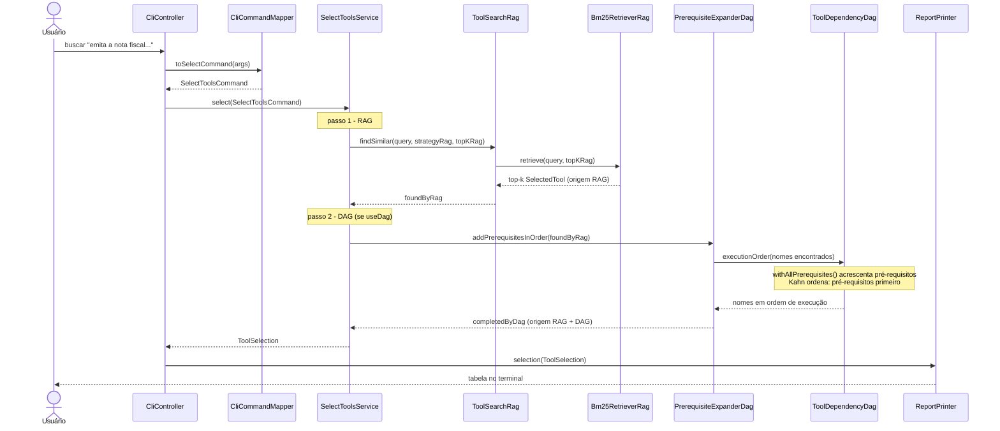
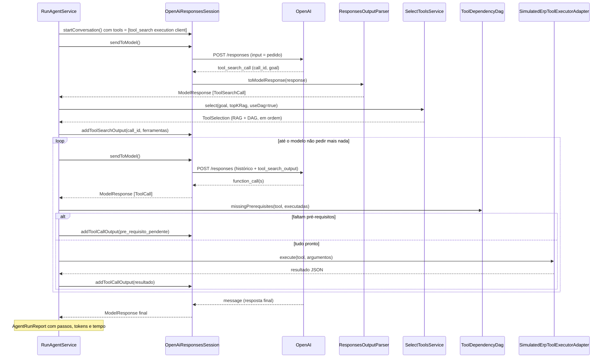
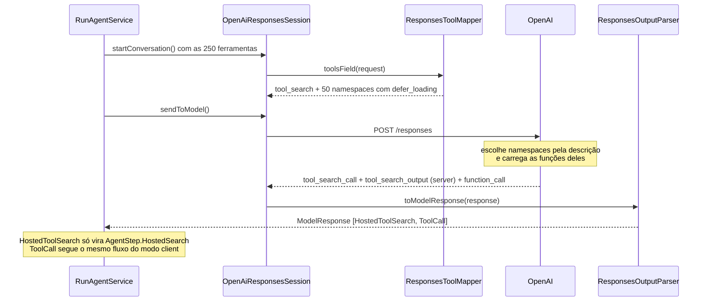
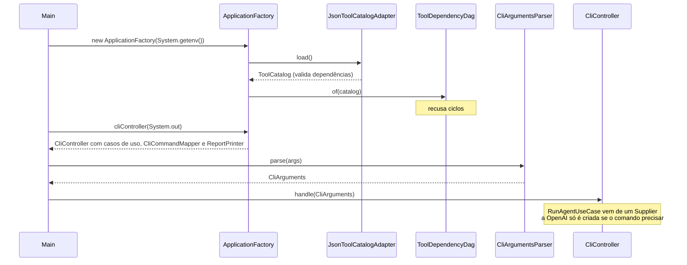

# Diagramas de sequência

Nomes reais das classes e métodos do projeto.

<!-- externos: Usuário, OpenAI -->

## 1. Busca de ferramentas (RAG + DAG), sem modelo de linguagem

`./toolsearch buscar "emita a nota fiscal do pedido 42"`

## 2. Agente com tool search no cliente (modo `client`)

`./toolsearch agente "Emita a nota fiscal do pedido de venda 42" --modo client`

## 3. Agente com tool search hospedado (modo `hosted`)

A diferença: a busca acontece dentro da OpenAI. A aplicação só observa.

## 4. Composição (composition root)

